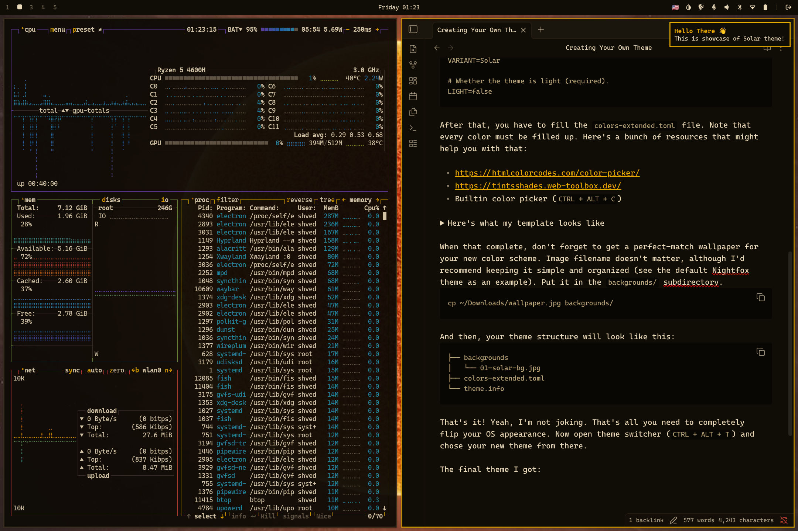
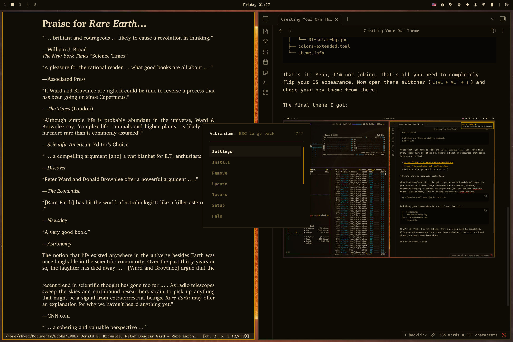

# Making your own theme

Vibranium themes are generated from a shared color palette.
A complete theme can be created by defining `colors.list`, adding metadata, and providing wallpapers.
The theme engine then generates application configurations from templates.

This page covers two approaches:

- **Template-only themes** — fast creation using generated configs.
- **Traditional themes** — manual application-specific customization.

## Template-only method

A template-based theme requires three components:

- `colors.list`
- `theme.info`
- At least one image in `backgrounds/`

## Step 1: create the theme directory

Create a new theme directory:

```bash
ccd ~/.config/vibranium/themes/solar
```

`ccd` is a Vibranium shell helper that creates a directory and enters it immediately.

## Step 2: create theme metadata

Create `theme.info` in the theme root:

```bash
# Theme family name.
# Used as a submenu entry in the theme picker.
# Leave empty for standalone themes.
FAMILY=

# Theme variant name.
# Required. For standalone themes this is the theme name.
VARIANT=Solar

# Whether this is a light theme.
# Required.
LIGHT=false
```

## Step 3: define the color palette

The main theme file is:

```text
colors.list
```

Every color value must be defined.

Useful tools:

* [HTML Color Picker](https://htmlcolorcodes.com/color-picker/)
* [Tint & Shade Generator](https://tintsshades.web-toolbox.dev/)
* Color picker (++ctrl+alt+c++)

??? note "Click here to copy the empty tempalte"

    ```toml
    black   = ""
    red     = ""
    pink    = ""
    green   = ""
    yellow  = ""
    orange  = ""
    blue    = ""
    purple  = ""
    cyan    = ""
    white   = ""
    gray    = ""
    accent  = ""

    background = ""
    foreground = ""
    ```

Our example:

??? note "Click to expand"

    ```toml
    black   = "#2C2418"
    red     = "#C44030"
    pink    = "#B84068"
    green   = "#6E9040"
    yellow  = "#E8B800"
    orange  = "#E88020"
    blue    = "#2E60AE"
    purple  = "#7040B0"
    cyan    = "#2894B0"
    white   = "#D8C8A8"
    gray    = "#6A5C4C"
    accent  = "#E8A800"

    background = "#100C06"
    foreground = "#EAD9B8"
    ```

The palette contains:

* 11 color families.
* 1 background.
* 1 foreground.
* Accent colors.

`background` and `foreground` are the bases of the two shade ladders every application theme is built from.
A palette names no shade above them, and no shade below them either: the deepest surface and the brightest text are computed too.

Templates build every other shade from those two keys with the `|pop=` and `|dim=` operations, which shift a color's lightness toward the foreground or toward the background relative to the current theme mode:

| Shade | Placeholder |
| --- | --- |
| Deepest surface | `{{ background\|dim=0.03 }}` |
| Base | `{{ background }}` |
| Level 1 | `{{ background\|pop=0.06 }}` |
| Level 2 | `{{ background\|pop=0.12 }}` |
| Level 3 | `{{ background\|pop=0.18 }}` |
| Level 4 | `{{ background\|pop=0.24 }}` |
| Level 5 | `{{ background\|pop=0.30 }}` |

The foreground ladder runs the other way, from `{{ foreground }}` through `|dim=` at the same steps, with its own extreme at `{{ foreground\|pop=0.06 }}`:

| Shade | Placeholder |
| --- | --- |
| Brightest text | `{{ foreground\|pop=0.06 }}` |
| Base | `{{ foreground }}` |
| Level 1 | `{{ foreground\|dim=0.06 }}` |
| Level 2 | `{{ foreground\|dim=0.12 }}` |
| Level 3 | `{{ foreground\|dim=0.18 }}` |
| Level 4 | `{{ foreground\|dim=0.24 }}` |
| Level 5 | `{{ foreground\|dim=0.30 }}` |

The two extremes are not the same distance from their base, and that is deliberate: a background already sits at the far end of its range, so the deepest surface is half a step away, while a foreground needs a full step to read as brighter text than the body copy.

One step serves both directions because the operations read the theme mode: under `LIGHT=true` `pop=` darkens and `dim=` lightens, which is the ladder a light theme needs.
The ramp holds a color's hue and saturation, so a theme whose base is a saturated cream shades toward a stronger cream rather than toward gray.

Dimmed and brighter shades of the accent colours work the same way: they are not part of the palette either, and templates ask for them with `|dim=0.10` and `|pop=0.10`.

These values are consumed by the theme templates to generate application configurations.
For a complete example, see the default [Nightfox theme](https://github.com/shvedes/vibranium/tree/master/themes/nightfox).

## Step 4: add wallpapers

Add wallpapers inside:

```text
backgrounds/
```

It's recommended to keep filenames orderd like so:

```bash
backgrounds/01-<theme>-bg.jpg
backgrounds/02-<theme>-bg.jpg
backgrounds/03-<theme>-bg.jpg
```

Example:

```bash
cp ~/Downloads/wallpaper.jpg backgrounds/01-solar.jpg
```

The filename is not important.

The final structure:

```text
solar/
├── backgrounds/
│   └── 01-solar-jpg.jpg
├── colors.list
└── theme.info
```

??? tip "The result"

    

    ---

    

## Step 5: apply the theme

Open the theme picker and select the new theme.
The theme engine generates the required application configurations and applies the wallpaper.

Generated configurations can include:

* GTK
* Qt
* terminal themes
* notifications
* lock screen
* editor integrations

!!! tip "Palette quality matters"
    The generated result depends heavily on the quality of the color palette.
    Carefully tuned colors produce significantly better results.

## Traditional method

The traditional method allows per-application customization.

`colors.list` is still required because Vibranium generates base configurations regardless.

Additional files can be included in the theme directory to override generated configurations:

```text
theme/
├── colors.list
├── theme.info
├── backgrounds/
└── application overrides
```

Examples of manual overrides:

```text
foot.ini
neovim.lua
```

This method provides more control when a generated template does not match the desired result.

The default Nightfox theme is an example of a theme using additional manual configuration.

## Publishing themes

Community themes use the same directory structure.

Repositories should follow the naming convention:

```text
vibranium-theme-<name>
```

Themes can then be installed through:

**Vibranium Menu** -> **Install** -> **Theme**

See [Themes](themes.md) for installation details.
